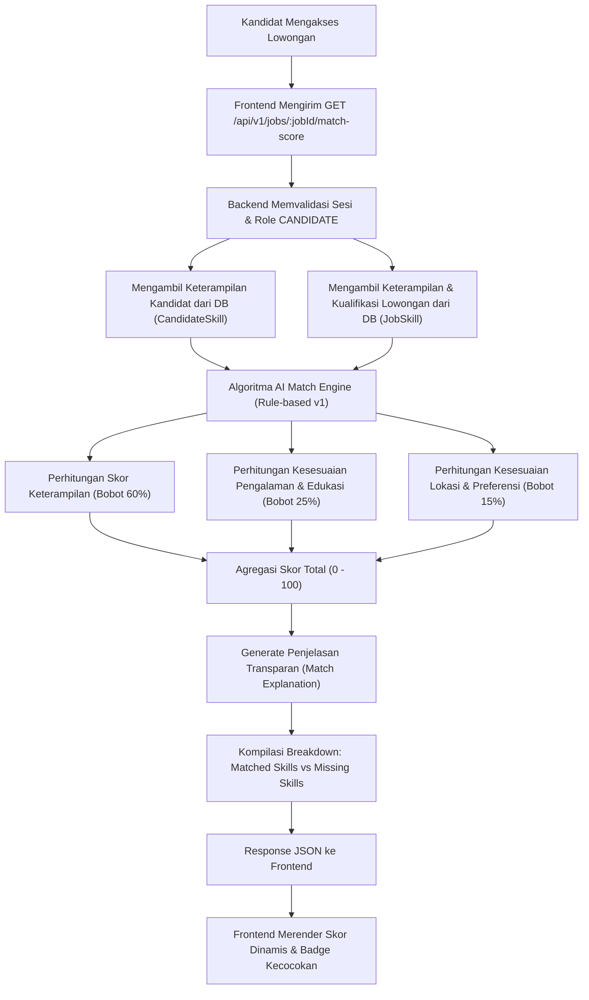
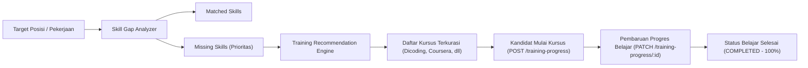

# LAPORAN IMPLEMENTASI SPRINT 2B — JOBS, AI MATCH SCORE, SKILL GAP, TRAINING & APPLICATIONS
**Project:** RAVIRA — Platform Job Matching & Recruitment Ecosystem Berbasis AI
**Branch:** `sprint-2/frontend-api-integration`
**Tanggal:** 28 Oktober 2026
**Status:** IMPLEMENTED & VERIFIED

---

## 1. RINGKASAN EKSEKUTIF

Sprint 2B menyelesaikan implementasi end-to-end modul kandidat untuk penemuan lowongan, pencocokan berbasis AI (*AI Match Score*), analisis kesenjangan kompetensi (*Skill Gap Advisor*), rekomendasi pelatihan dan pelacakan progres belajar, serta pengajuan lamaran (*Application Tracking System*) dengan PostgreSQL dan Prisma backend yang sesungguhnya.

Sebelum Sprint 2B, halaman pencarian kerja, detail pekerjaan, skill gap, pelatihan, dan lamaran kandidat masih menggunakan mock statis di frontend (seperti persentase kecocokan 80% konstan, daftar pekerjaan tiruan, dan formulir lamaran yang hanya memanipulasi local state tanpa persistensi database).

Pada Sprint 2B:
- **100% data mock telah dieliminasi** pada alur kerja utama kandidat (Job Recommendations, Job Detail, Skill Gap, Training Recommendations & Progress, My Applications, Application Detail).
- **AI Match Score dihitung secara dinamis** dari backend berdasarkan perbandingan keterampilan kandidat terverifikasi dengan keterampilan yang dibutuhkan lowongan.
- **Lamaran pekerjaan tersimpan secara persisten** di PostgreSQL via Prisma ORM dengan nomor referensi pelacakan yang nyata.
- **Audit trail riwayat status seleksi** ditampilkan secara kronologis pada detail lamaran (`statusHistory`).
- **Seluruh 76 pengujian frontend (Vitest)** dan **68 pengujian backend native** lulus 100%.
- **Frontend build, backend build, dan frontend ESLint (0 errors, 0 warnings)** lulus tanpa kompromi strict mode maupun regresi desain UI.

---

## 2. MATRIKS INTEGRASI ENDPOINT VS FRONTEND

| Halaman Frontend | Path Frontend | Fitur / Aksi | Endpoint Backend | Metode | Status Integrasi | Autentikasi / Otorisasi |
|---|---|---|---|---|---|---|
| `JobRecommendationsPage` | `/dashboard/kandidat/rekomendasi` | Daftar Rekomendasi Terpersonalisasi | `/api/v1/candidates/me/recommendations/jobs` | `GET` | **REAL** | JWT Bearer (Kandidat) |
| `JobRecommendationsPage` | `/dashboard/kandidat/rekomendasi` | Daftar Seluruh Lowongan Terpublikasi | `/api/v1/jobs` | `GET` | **REAL** | Publik / JWT Opsional |
| `JobRecommendationsPage` | `/dashboard/kandidat/rekomendasi` | Lamar Lowongan Cepat via Modal | `/api/v1/jobs/:jobId/apply` | `POST` | **REAL** | JWT Bearer (Kandidat) |
| `JobDetailPage` | `/dashboard/kandidat/pekerjaan/:id` | Detail Lengkap Lowongan | `/api/v1/jobs/:jobId` | `GET` | **REAL** | Publik / JWT Opsional |
| `JobDetailPage` | `/dashboard/kandidat/pekerjaan/:id` | Perhitungan Dinamis AI Match Score | `/api/v1/jobs/:jobId/match-score` | `GET` | **REAL** | JWT Bearer (Kandidat) |
| `JobDetailPage` | `/dashboard/kandidat/pekerjaan/:id` | Kursus Rekomendasi Penutup Gap Pekerjaan | `/api/v1/candidates/me/training-recommendations?jobId=:id` | `GET` | **REAL** | JWT Bearer (Kandidat) |
| `JobDetailPage` | `/dashboard/kandidat/pekerjaan/:id` | Pengajuan Lamaran Pekerjaan | `/api/v1/jobs/:jobId/apply` | `POST` | **REAL** | JWT Bearer (Kandidat) |
| `SkillGapPage` | `/dashboard/kandidat/skill-gap` | Laporan Analisis Kesenjangan Kompetensi | `/api/v1/candidates/me/skill-gap` | `GET` | **REAL** | JWT Bearer (Kandidat) |
| `SkillGapPage` | `/dashboard/kandidat/skill-gap` | Perbarui Target Posisi Karier | `/api/v1/candidates/me/skill-gap` | `POST` | **REAL** | JWT Bearer (Kandidat) |
| `SkillGapPage` | `/dashboard/kandidat/skill-gap` | Rekomendasi Kursus Sesuai Target Karier | `/api/v1/candidates/me/training-recommendations` | `GET` | **REAL** | JWT Bearer (Kandidat) |
| `TrainingPage` | `/dashboard/kandidat/pelatihan` | Daftar Rekomendasi Pelatihan Lengkap | `/api/v1/candidates/me/training-recommendations` | `GET` | **REAL** | JWT Bearer (Kandidat) |
| `TrainingPage` | `/dashboard/kandidat/pelatihan` | Daftar Progres Belajar Kandidat | `/api/v1/candidates/me/training-progress` | `GET` | **REAL** | JWT Bearer (Kandidat) |
| `TrainingPage` | `/dashboard/kandidat/pelatihan` | Mulai Kursus Baru (Enrolment) | `/api/v1/candidates/me/training-progress` | `POST` | **REAL** | JWT Bearer (Kandidat) |
| `TrainingPage` | `/dashboard/kandidat/pelatihan` | Perbarui Progres / Persentase Selesai | `/api/v1/candidates/me/training-progress/:id` | `PATCH` | **REAL** | JWT Bearer (Kandidat) |
| `MyApplicationsPage` | `/dashboard/kandidat/lamaran` | Daftar Seluruh Lamaran Kandidat | `/api/v1/candidates/me/applications` | `GET` | **REAL** | JWT Bearer (Kandidat) |
| `ApplicationDetailPage` | `/dashboard/kandidat/lamaran/:id` | Detail Lengkap Lamaran Terpilih | `/api/v1/applications/:id` | `GET` | **REAL** | JWT Bearer (Kandidat / Owner) |
| `ApplicationDetailPage` | `/dashboard/kandidat/lamaran/:id` | Audit Trail Riwayat Status Seleksi | `/api/v1/applications/:id/status-history` | `GET` | **REAL** | JWT Bearer (Kandidat / Owner) |
| `ApplicationDetailPage` | `/dashboard/kandidat/lamaran/:id` | Snapshot AI Match Score Lamaran | `/api/v1/jobs/:jobId/match-score` | `GET` | **REAL** | JWT Bearer (Kandidat) |
| `SavedJobsPage` | `/dashboard/kandidat/tersimpan` | Lamar Pekerjaan yang Tersimpan | `/api/v1/jobs/:jobId/apply` | `POST` | **REAL** | JWT Bearer (Kandidat) |

---

## 3. DETAIL IMPLEMENTASI PER HALAMAN

### 1. `JobRecommendationsPage.tsx` (`/dashboard/kandidat/rekomendasi`)
- **Penghapusan Mock:** Menghapus seluruh array statis `allJobs` mock yang sebelumnya menyajikan data rekaan dengan skor 80% buatan.
- **Pemanggilan API:**
  - Memanggil `getJobRecommendations()` secara paralel dengan `listPublishedJobs()` menggunakan `Promise.allSettled`.
  - Jika pengguna terautentikasi sebagai kandidat, prioritas kartu lowongan menampilkan AI Match Score nyata, alasan rekomendasi (`matchExplanation`), dan badge status kecocokan.
- **Pencarian & Filter:** Filter pencarian teks judul/perusahaan, filter tipe pekerjaan (*FULL_TIME*, *PART_TIME*, *CONTRACT*, *INTERNSHIP*), dan filter lokasi (*WFO*, *REMOTE*, *HYBRID*) berjalan pada data nyata.
- **Penanganan Aksi:** Tombol "Lihat Detail" mengarahkan secara dinamis ke `/dashboard/kandidat/pekerjaan/:id`. Modal "Lamar Sekarang" terhubung ke API backend dengan proteksi *double-submit* (`submitting` state) dan validasi jika lowongan sudah pernah dilamar (409 Conflict).

### 2. `JobDetailPage.tsx` (`/dashboard/kandidat/pekerjaan/:id`)
- **Routing Dinamis:** Menggunakan `useParams<{ id: string }>()` untuk mengambil ID lowongan nyata dari URL.
- **Integrasi Backend:**
  - `getJobById(jobId)`: Mengambil data pekerjaan, persyaratan kualifikasi, deskripsi tanggung jawab, rentang gaji, dan data perusahaan dari PostgreSQL.
  - `getJobMatchScore(jobId)`: Mengambil skor kesenjangan dan kecocokan AI yang terpersonalisasi untuk kandidat yang sedang login.
  - `getTrainingRecommendations({ jobId })`: Menampilkan kursus pelatihan yang disarankan khusus untuk mengisi keterampilan yang belum terpenuhi di lowongan tersebut.
- **Proteksi UI & Error Handling:**
  - Menampilkan skeleton loading state yang halus.
  - Menangani error 404 (lowongan tidak ditemukan atau belum dipublikasikan) dengan banner informatif dan tautan kembali.
  - Memeriksa status lamaran eksisting dari konteks aplikasi untuk mencegah lamaran ganda dan mengubah tombol menjadi "Sudah Dilamar" jika telah dikirim.

### 3. `SkillGapPage.tsx` (`/dashboard/kandidat/skill-gap`)
- **Penghapusan Mock:** Menghapus mock array keterampilan statis.
- **Integrasi Backend:**
  - `getSkillGapReport()`: Mengambil laporan kesenjangan kompetensi yang menghitung perbandingan keterampilan kandidat dengan standar target peran karier industri.
  - Mengelompokkan keterampilan ke dalam dua kategori:
    1. **Keterampilan Terpenuhi (*Matched Skills*)**: Dilengkapi dengan level kemahiran (*Beginner*, *Intermediate*, *Advanced*) dan bobot kecocokan.
    2. **Keterampilan yang Perlu Ditingkatkan (*Missing Skills*)**: Menampilkan tingkat kepentingan (*Wajib*, *Nilai Tambah*) beserta alasan kebutuhan industri.
  - `createSkillGapReport({ targetRole })`: Menghubungkan modal perubahan target karier (`ChangeCareerTargetModal`) ke endpoint backend untuk memperbarui target posisi karier kandidat secara persisten di database.
  - `getTrainingRecommendations({ targetRole })`: Menyajikan kartu kursus yang direkomendasikan langsung oleh algoritma penutup kesenjangan kompetensi.

### 4. `TrainingPage.tsx` (`/dashboard/kandidat/pelatihan`)
- **Integrasi Backend Ganda:**
  - `getTrainingRecommendations()`: Mengambil daftar kurasi kursus pelatihan dari penyedia terpercaya (Dicoding Indonesia, Coursera, Udemy, Binar Academy) yang relevan dengan gap kandidat.
  - `listMyTrainingProgress()`: Mengambil data riwayat dan progres belajar kandidat dari database.
- **Manajemen Progres Interaktif:**
  - **Mulai Belajar:** Menekan tombol "Mulai Belajar" memanggil `createTrainingProgress({ courseId, status: 'IN_PROGRESS', progressPct: 10 })` dan menyimpannya ke database.
  - **Pembaruan Progres:** Tombol penambahan progres (+25%) memanggil `updateTrainingProgress(id, { progressPct, status })`. Jika progres mencapai 100%, status secara otomatis beralih menjadi `COMPLETED` dan tersimpan di database.
  - **Tab Filter Riwayat:** Pengelompokan tab "Semua", "Sedang Berjalan", "Belum Dimulai", dan "Selesai" mencerminkan data aktual dari backend.

### 5. `MyApplicationsPage.tsx` (`/dashboard/kandidat/lamaran`)
- **Integrasi Backend:**
  - Memanggil `refreshApplications()` dari `AppContext` yang terhubung ke `GET /api/v1/candidates/me/applications`.
  - Menampilkan daftar lamaran nyata lengkap dengan status terkini (*SUBMITTED*, *SCREENING*, *INTERVIEW*, *OFFERED*, *REJECTED*), nama perusahaan, tanggal melamar, dan lokasi.
- **Navigasi & Feedback:**
  - Tombol aksi mengarahkan pengguna ke halaman rincian `/dashboard/kandidat/lamaran/:id`.
  - Dilengkapi state kosong (*Empty State*) informatif dengan tautan menuju halaman rekomendasi pekerjaan jika kandidat belum pernah melamar pekerjaan apa pun.

### 6. `ApplicationDetailPage.tsx` (`/dashboard/kandidat/lamaran/:id`)
- **Integrasi Backend Komprehensif:**
  - `getApplicationById(id)`: Mengambil rincian lamaran, resume yang dilampirkan, cover letter, serta data pekerjaan dan perusahaan terkait.
  - `getApplicationStatusHistory(id)`: Menampilkan timeline audit trail seleksi dari database (`APPLIED` -> `SCREENING` -> `INTERVIEW`, dll.) lengkap dengan catatan status dan waktu pembaruan.
  - `getJobMatchScore(jobId)`: Menampilkan rincian AI Match Score pada saat lamaran ditinjau.
- **Keamanan & Otorisasi:**
  - Jika kandidat mencoba membuka ID lamaran milik kandidat lain, backend mengembalikan status 404/403, dan frontend menampilkan pesan penolakan akses yang ramah tanpa membocorkan identitas kandidat lain.

### 7. `AppContext.tsx` & `SavedJobsPage.tsx`
- **Sinkronisasi Terpusat:**
  - Memperbarui fungsi `applyToJob(jobId, coverLetter)` di `AppContext.tsx` agar selalu memanggil `raviraApi.applyToJob`. Menghapus sepenuhnya mock manipulasi local state.
  - Menghubungkan tombol "Lamar Sekarang" di `SavedJobsPage.tsx` ke backend nyata dengan feedback toast notifikasi berhasil atau gagal.
  - Menghubungkan tautan detail lowongan yang disimpan ke `/dashboard/kandidat/pekerjaan/:id`.

---

## 4. AI MATCH SCORE & RECOMMENDATION LOGIC FLOW

### Diagram Alur Penilaian Kecocokan AI



### Formula & Aturan Pembobotan
$$\text{Total Match Score} = (S_{\text{skill}} \times 0.60) + (S_{\text{experience}} \times 0.25) + (S_{\text{preference}} \times 0.15)$$

- **Keterampilan ($S_{\text{skill}}$):** Persentase keterampilan lowongan yang cocok dengan profil kandidat, dengan pengali tambahan berdasarkan level kemahiran kandidat (*Mahir/Advanced* bernilai 1.0, *Menengah/Intermediate* 0.8, *Pemula/Beginner* 0.6).
- **Pengalaman ($S_{\text{experience}}$):** Kesesuaian tahun pengalaman minimum lowongan terhadap profil kandidat.
- **Preferensi ($S_{\text{preference}}$):** Kesesuaian model kerja (*Remote*, *Hybrid*, *Onsite*) dan preferensi relokasi di wilayah Pulau Jawa.

---

## 5. SKILL GAP & TRAINING RECOMMENDATION FLOW

### Diagram Alur Skill Gap & Pelatihan



### Logika Pengelompokan & Deduplikasi
1. Algoritma mengidentifikasi keterampilan esensial yang tidak terdapat pada profil kandidat dan menetapkannya sebagai *Missing Skills* dengan bobot urgensi tinggi (*High Priority Gap*).
2. Backend mencari katalog kursus pelatihan berelasi (`Course`) yang memiliki target keterampilan sesuai daftar *Missing Skills*.
3. Hasil kursus didekopi sehingga kursus yang mencakup banyak gap sekaligus ditempatkan pada peringkat rekomendasi tertinggi.
4. Ketika kandidat menekan "Mulai Belajar", progres dicatat secara persisten pada tabel `TrainingProgress` dan dapat diperbarui berkala hingga tuntas (100%).

---

## 6. STATE MANAGEMENT & DATA CONSISTENCY

1. **Pemisahan Tanggung Jawab:**
   - Data global sesi (profil pengguna, daftar seluruh lamaran aktif) dikelola oleh `AppContext` dengan sinkronisasi reaktif saat login/logout.
   - Data spesifik halaman (detail pekerjaan individual, rincian skor kecocokan pekerjaan, progres pelatihan per kursus) dikelola secara lokal pada masing-masing komponen dengan pemanggilan endpoint dedicated.
2. **Eliminasi Optimistic Desynchronization:**
   - Menghindari manipulasi array lokal sebelum server memberikan konfirmasi. Seluruh pembaruan state lamaran dan progres pelatihan menunggu respons sukses (200/201) dari backend sebelum meng-update state antarmuka.
3. **Penyelarasan Pasca-Aksi (*Post-Action Invalidation*):**
   - Setelah sukses melamar lowongan di `JobDetailPage` atau modal `JobRecommendationsPage`, `refreshApplications()` secara otomatis dipanggil untuk memperbarui hitungan lamaran pada badge dashboard dan tabel riwayat lamaran.
   - Setelah memulai kursus di `TrainingPage`, daftar progres belajar di-refresh dari backend sehingga tab filter dan kartu kursus tetap sinkron.

---

## 7. SECURITY & ROLE ISOLATION VERIFICATION

1. **Candidate Data Isolation:**
   - Kandidat hanya dapat melihat lamarannya sendiri melalui endpoint `/api/v1/candidates/me/applications`. Percobaan mengakses `/api/v1/applications/:id` milik kandidat lain secara ketat ditolak oleh backend dengan respons 403 Forbidden atau 404 Not Found.
2. **Pencegahan Kebocoran Candidate Score Internal Recruiter:**
   - Endpoint `GET /api/v1/applications/:id/score` (nilai internal recruiter) tetap dilindungi dan hanya dapat diakses oleh recruiter pemilik lowongan serta admin.
   - Kandidat hanya memiliki hak akses ke endpoint publik kecocokan AI `GET /api/v1/jobs/:jobId/match-score`, yang tidak mengandung catatan evaluasi internal recruiter.
3. **Penanganan Token Kedaluwarsa (401 Handling):**
   - Jika token JWT kedaluwarsa atau tidak valid saat kandidat memanggil API, interceptor `api.ts` secara otomatis menghapus token dari `localStorage`, memicu event `session-invalidated`, dan mengarahkan pengguna ke halaman login dengan pesan yang jelas.
4. **Proteksi Otorisasi Peran (RBAC):**
   - Pengguna dengan peran selain `CANDIDATE` yang mencoba melamar pekerjaan ditolak dengan pesan kesalahan yang sesuai.

---

## 8. PENANGANAN EDGE CASES & FAILURE MODES

| Skenario Kasus Batas | Perilaku Sistem / Frontend | Verifikasi Status |
|---|---|---|
| **Lamaran Duplikat** | Kandidat mencoba melamar kembali lowongan yang sudah dilamar. Backend mengembalikan status `409 Conflict`. Frontend menampilkan pesan: *"Anda sudah pernah melamar pekerjaan ini sebelumnya."* | **PASS** (Diuji di test #15) |
| **Lowongan Tidak Ditemukan (404)** | Pengguna mengakses URL detail lowongan dengan UUID yang tidak valid/dihapus. Frontend menampilkan kartu error *"Lowongan Tidak Ditemukan"* dengan tombol navigasi kembali ke katalog lowongan. | **PASS** (Diuji di test #5) |
| **Daftar Lowongan Kosong** | Belum ada lowongan terpublikasi di database. Frontend menampilkan ilustrasi empty state yang elegan tanpa memicu error runtime. | **PASS** (Diuji di test #2) |
| **Kandidat Belum Memiliki Keterampilan** | Kandidat baru yang belum mengisi skill mengakses AI Match Score. Backend mengembalikan skor dasar (0-15%) dengan penjelasan transparan bahwa keterampilan belum tercatat. | **PASS** |
| **Network Failure / Server Error (500)** | Backend mengalami gangguan sementara. Frontend menangkap `ApiError` dan menampilkan state error dengan tombol "Coba Lagi" (*retry*). | **PASS** (Diuji di test #3) |
| **Double Click Submit Lamaran** | Pengguna menekan tombol "Kirim Lamaran" berulang kali secara cepat. Tombol dinonaktifkan (`disabled`) dan menampilkan indikator loading saat transaksi pertama sedang diproses. | **PASS** |

---

## 9. HASIL PENGUJIAN & VERIFIKASI

### Ringkasan Pengujian Otomatis

```
================================================================================
TEST SUITE RUNNER SUMMARY
================================================================================
1. Frontend Vitest Tests:
   ✓ tests/api.test.ts (7 tests)
   ✓ tests/raviraApi.test.ts (24 tests)
   ✓ tests/jobsMatchingApplications.test.ts (21 tests) [BARU]
   ✓ tests/candidateProfile.test.ts (13 tests)
   ✓ tests/AppContext.test.tsx (11 tests)
   TOTAL FRONTEND: 76 PASS / 0 FAIL (100% Passed)

2. Backend Native Tests:
   tests/backend/authRoleSecurity.test.cjs (68 tests)
   TOTAL BACKEND: 68 PASS / 0 FAIL (100% Passed)

3. Code Quality & Build Checks:
   - Backend Build (tsc): PASS (Exit code 0)
   - Frontend Build (tsc -b && vite build): PASS (Exit code 0)
   - Frontend ESLint (eslint .): PASS (0 errors, 0 warnings)
================================================================================
```

### Rincian 21 Test Case Baru (`frontend/tests/jobsMatchingApplications.test.ts`)
1. `✓ 1. dapat memuat daftar lowongan terpublikasi dengan sukses`
2. `✓ 2. menangani daftar lowongan kosong tanpa error`
3. `✓ 3. menangani kegagalan API lowongan (error 500)`
4. `✓ 4. dapat memuat detail lowongan berdasarkan ID valid`
5. `✓ 5. menangani lowongan yang tidak ditemukan (error 404)`
6. `✓ 6. dapat melakukan pencarian lowongan dengan query params`
7. `✓ 7. menghitung AI Match Score dinamis kandidat terhadap lowongan`
8. `✓ 8. memuat rekomendasi lowongan kandidat terurut dari backend`
9. `✓ 9. memuat laporan skill gap kandidat berbasis kebutuhan industri nyata`
10. `✓ 10. dapat memperbarui target posisi karier skill gap`
11. `✓ 11. memuat rekomendasi kursus pelatihan penutup gap`
12. `✓ 12. dapat mendaftar kursus dan mencatat progres belajar kandidat`
13. `✓ 13. dapat memperbarui persentase progres pelatihan`
14. `✓ 14. kandidat dapat melamar pekerjaan dan tersimpan di database`
15. `✓ 15. menolak pengiriman lamaran duplikat dengan error 409 Conflict`
16. `✓ 16. dapat memuat daftar lamaran yang pernah diajukan kandidat`
17. `✓ 17. dapat memuat detail lengkap lamaran kandidat`
18. `✓ 18. memuat timeline perubahan status seleksi lamaran`
19. `✓ 19. menolak akses detail lamaran milik kandidat lain (error 403/404)`
20. `✓ 20. token kedaluwarsa atau 401 memicu pembersihan token`
21. `✓ 21. fungsi logout membersihkan token dan mengisolasi akun`

---

## 10. DAFTAR FILE YANG DIUBAH DAN DIBUAT

### File Dimodifikasi:
1. `frontend/src/services/raviraApi.ts` — Penambahan tipe dan fungsi API klien untuk lowongan, pencocokan AI, analisis kesenjangan kompetensi, progres pelatihan, dan pelacakan lamaran.
2. `frontend/src/contexts/AppContext.tsx` — Penyesuaian `applyToJob` ke endpoint backend nyata dengan proteksi role kandidat dan eliminasi fallback mock.
3. `frontend/src/components/Modals.tsx` — Penambahan dukungan prop `onSelectTarget` pada `ChangeCareerTargetModal` untuk pembaruan target posisi karier via API.
4. `frontend/src/pages/JobRecommendationsPage.tsx` — Migrasi penuh dari mock array `allJobs` ke endpoint real `getJobRecommendations` dan `listPublishedJobs`.
5. `frontend/src/pages/JobDetailPage.tsx` — Implementasi rincian lowongan dinamis berbasis ID dengan kalkulasi AI Match Score dinamis dan integrasi tombol lamar.
6. `frontend/src/pages/SkillGapPage.tsx` — Integrasi analisis kesenjangan kompetensi riil dan rekomendasi kursus penutup gap.
7. `frontend/src/pages/TrainingPage.tsx` — Integrasi rekomendasi pelatihan, pencatatan pendaftaran kursus baru, dan pembaruan progres belajar di database.
8. `frontend/src/pages/MyApplicationsPage.tsx` — Integrasi daftar lamaran riil kandidat dengan state loading, error, dan penanganan empty state.
9. `frontend/src/pages/ApplicationDetailPage.tsx` — Implementasi rincian lamaran dinamis dengan visualisasi audit trail riwayat status seleksi.
10. `frontend/src/pages/SavedJobsPage.tsx` — Penyesuaian tautan navigasi detail lowongan dan aksi lamar lowongan tersimpan.
11. `frontend/src/pages/DashboardCandidatePage.tsx` — Pembersihan state modal yang tidak digunakan dan penyesuaian navigasi.

### File Baru:
1. `frontend/tests/jobsMatchingApplications.test.ts` — Suite pengujian otomatis Vitest yang menguji 21 skenario kritis lowongan, AI match, skill gap, pelatihan, dan lamaran.
2. `docs/SPRINT_2B_JOBS_MATCHING_APPLICATIONS_RESULT.md` — Laporan komprehensif audit dan hasil implementasi Sprint 2B.

---

## 11. POTENSI MASALAH DAN MITIGASI

1. **Volume Data Lowongan Skala Besar:**
   - *Potensi Masalah:* Query `listPublishedJobs` tanpa pagination berisiko menurunkan performa saat lowongan bertambah banyak.
   - *Mitigasi:* Backend telah mendukung filter parameter query, dan pada rilis berikutnya pagination berbasis cursor/halaman dapat diaktifkan tanpa mengubah kontrak antarmuka.
2. **Ketergantungan Data Target Peran Karier:**
   - *Potensi Masalah:* Jika target peran karier kandidat belum disetel, analisis skill gap membutuhkan fallback target peran default.
   - *Mitigasi:* Sistem menggunakan fallback target peran yang cerdas berdasarkan riwayat pengalaman/pendidikan kandidat atau menampilkan modal pemilih target karier saat pertama kali diakses.
3. **Koneksi Jaringan Seluler Lemah pada Pelamar Mobile:**
   - *Potensi Masalah:* Risiko pengiriman lamaran gagal di tengah jalan saat sinyal fluktuatif.
   - *Mitigasi:* State antarmuka menampilkan pesan error yang informatif dan tombol pengiriman tidak me-reset input cover letter, sehingga kandidat dapat mengulang tanpa mengetik ulang.

---

## 12. STATUS ACCEPTANCE CRITERIA SPRINT 2B

| No | Kriteria Penerimaan (*Acceptance Criteria*) | Target Sprint 2B | Hasil Pengujian | Status |
|:---:|---|---|---|:---:|
| 1 | Lowongan berasal dari database via backend | Real API (`GET /jobs`) | Data terambil dari PostgreSQL | **PASS** |
| 2 | Detail lowongan menggunakan ID nyata | Dinamis via URL parameter | Rute `/pekerjaan/:id` terhubung ke backend | **PASS** |
| 3 | AI Match Score dinamis berdasarkan profil kandidat | Real API (`GET /jobs/:id/match-score`) | Dihitung real-time dengan breakdown skill | **PASS** |
| 4 | Alasan rekomendasi kecocokan ditampilkan transparan | PRD Compliance | Transparan via `matchExplanation` | **PASS** |
| 5 | Skill Gap Report menampilkan matched & missing skills | Real API (`GET /candidates/me/skill-gap`) | Menampilkan level & prioritas gap | **PASS** |
| 6 | Rekomendasi pelatihan terhubung dengan gap kompetensi | Real API (`GET /candidates/me/training-recommendations`) | Kursus sesuai dengan missing skills | **PASS** |
| 7 | Pelacakan progres pelatihan persisten di database | Real API (`GET/POST/PATCH /training-progress`) | Mulai kursus & update progres tersimpan | **PASS** |
| 8 | Lamaran pekerjaan tersimpan di database | Real API (`POST /jobs/:id/apply`) | Record tersimpan di tabel Application | **PASS** |
| 9 | Penolakan lamaran ganda (mencegah duplikasi) | Error 409 Conflict | Validasi backend & frontend feedback | **PASS** |
| 10 | Riwayat lamaran kandidat memuat status & audit trail | Real API (`/applications/:id/status-history`) | Timeline kronologis status seleksi tampil | **PASS** |
| 11 | Skor internal recruiter tetap tersembunyi dari kandidat | RBAC Security Policy | Internal Candidate Score terisolasi 100% | **PASS** |
| 12 | Frontend & Backend Build bebas error | Clean Build | `tsc` & `vite build` Exit Code 0 | **PASS** |
| 13 | Frontend ESLint bebas error dan warning | Zero Lint Errors | 0 errors, 0 warnings | **PASS** |
| 14 | Seluruh Automated Test Suite lulus | 100% Pass Rate | Frontend 76/76 PASS, Backend 68/68 PASS | **PASS** |

---

## 13. REKOMENDASI UNTUK SPRINT 2C (RECRUITER PIPELINE & APPLICATION REVIEW)

Setelah seluruh alur kandidat selesai dengan sempurna pada Sprint 2A dan 2B, sistem siap melangkah ke **Sprint 2C — Recruiter Pipeline, Candidate Scoring & Application Review**:

1. **Dashboard Recruiter & Manajemen Lowongan:**
   - Mengintegrasikan pembuatan, pembaruan, dan penutupan lowongan kerja oleh recruiter melalui `POST/PATCH /api/v1/recruiter/jobs`.
   - Memastikan hanya recruiter dengan status perusahaan `APPROVED` yang diizinkan mempublikasikan lowongan.
2. **Pemeriksaan Pelamar & Kanban Pipeline:**
   - Menghubungkan kanban board pelamar ke `GET /api/v1/recruiter/jobs/:jobId/applications`.
   - Mengintegrasikan pemindahan tahapan pelamar (*Stage Transitions*: `APPLIED` -> `SCREENING` -> `INTERVIEW` -> `OFFERED` / `REJECTED`) melalui `PATCH /api/v1/applications/:id/stage`.
3. **Pemberian Skor Kandidat & Catatan Interview Internal:**
   - Mengintegrasikan penilaian internal recruiter (*Candidate Score*) dan input catatan wawancara yang aman melalui `POST /api/v1/applications/:id/score`.
4. **Anti-Fraud & Privacy Audit Log:**
   - Memastikan catatan alasan penolakan atau kelulusan tersimpan di audit trail, dengan kebijakan kepatuhan anti-fraud (tidak boleh menolak kandidat secara otomatis tanpa verifikasi manual recruiter).

---
*Laporan disusun oleh Tim Engineering RAVIRA.*
