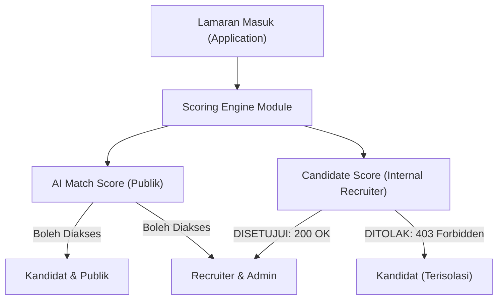
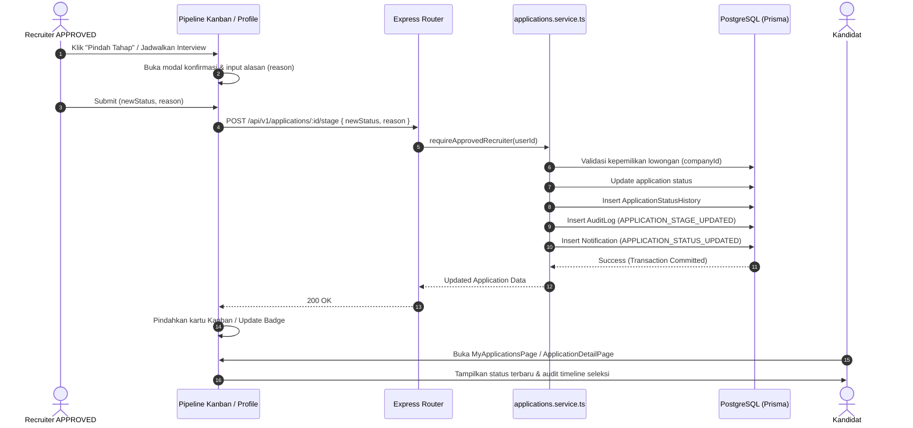

# LAPORAN IMPLEMENTASI SPRINT 2C — RECRUITER JOBS, CANDIDATE SCORE & RECRUITMENT PIPELINE
**Project:** RAVIRA — Platform Job Matching & Recruitment Ecosystem Berbasis AI  
**Branch:** `sprint-2/frontend-api-integration`  
**Tanggal:** 28 Oktober 2026  
**Status:** IMPLEMENTED & VERIFIED  

---

## 1. RINGKASAN EKSEKUTIF

Sprint 2C menyelesaikan integrasi penuh modul Recruiter, manajemen lowongan (*Job CRUD*), pengelolaan dan penilaian pelamar (*Applicant Management & Candidate Scoring*), serta papan kanban rekrutmen (*Recruitment Pipeline*) dengan backend PostgreSQL dan Prisma ORM.

Sebelum Sprint 2C, dashboard recruiter, daftar lowongan, daftar pelamar, dan kanban pipeline masih dipenuhi data prototype statis (nama recruiter "Siti Rahayu", perusahaan "Tokopedia", kandidat dummy seperti "Budi Santoso", statistik pelamar rekaan, dan manipulasi status lokal tanpa persistensi server).

Pada Sprint 2C:
- **100% data mock & placeholder statis telah dieliminasi** dari halaman recruiter utama: `DashboardCompanyPage`, `CreateJobPage`, `ActiveJobsPage`, `CandidatesListPage`, `CandidateProfilePage`, dan `PipelinePage`.
- **Manajemen Lowongan Riil**: Recruiter terverifikasi (`APPROVED`) dapat membuat lowongan baru (`POST /api/v1/recruiter/jobs`), melihat lowongan perusahaannya sendiri (`GET /api/v1/recruiter/jobs`), mengubah status (`PATCH /api/v1/recruiter/jobs/:jobId`), serta menutup/mengarsipkan lowongan (`DELETE /api/v1/recruiter/jobs/:jobId`).
- **Pengelolaan Pelamar Terisolasi**: Recruiter hanya dapat melihat dan menilai pelamar yang melamar pada lowongan milik perusahaannya sendiri (`GET /api/v1/recruiter/jobs/:jobId/applications`).
- **Integrasi Candidate Score Internal**: Skor evaluasi internal recruiter terhubung ke endpoint `/api/v1/applications/:applicationId/score` dan `/api/v1/recruiter/jobs/:jobId/candidate-scores` dengan isolasi ketat sehingga kandidat tidak dapat mengakses skor internal ini.
- **Papan Rekrutmen Kanban Persisten**: Perpindahan tahap seleksi pelamar terhubung langsung ke backend via `POST /api/v1/applications/:applicationId/stage` dengan validasi alasan (*reason*) wajib, pencatatan kronologis pada `ApplicationStatusHistory`, audit log, dan pengiriman notifikasi pembaruan status ke kandidat.
- **Pengujian & Kualitas Kode**:
  - Seluruh **94 pengujian frontend (Vitest)** lulus 100% (termasuk 18 pengujian baru untuk modul recruiter di `recruiterPipeline.test.ts`).
  - Seluruh **68 pengujian backend native** lulus 100%.
  - Frontend build, backend build, dan frontend linting (ESLint) bersih dengan **0 errors dan 0 warnings**.
  - Tidak ada regresi desain visual, layout, palet warna, maupun estetika UI Ravira.

---

## 2. FILE YANG DIMODIFIKASI DAN DIBUAT

### File Frontend Dimodifikasi:
1. `frontend/src/services/raviraApi.ts` — Penambahan tipe dan fungsi API klien untuk recruiter jobs, candidate score, pelamar lowongan, dan transisi tahap seleksi.
2. `frontend/src/pages/DashboardCompanyPage.tsx` — Mengganti profil statis "Siti Rahayu" & "Tokopedia" dengan sesi recruiter aktif, menghitung statistik nyata dari database, menampilkan pelamar terbaru riil, dan menyajikan tab pipeline & lowongan berbasis PostgreSQL.
3. `frontend/src/pages/CreateJobPage.tsx` — Integrasi form pembuatan lowongan dengan endpoint `POST /api/v1/recruiter/jobs`, validasi schema Zod, penanganan status `DRAFT` dan `PUBLISHED`, serta proteksi *double-submit*.
4. `frontend/src/pages/ActiveJobsPage.tsx` — Menampilkan daftar lowongan perusahaan riil, integrasi penghitungan pelamar per posisi, serta modal konfirmasi penutupan lowongan via API.
5. `frontend/src/pages/CandidatesListPage.tsx` — Menghapus array `allCandidates` tiruan; memuat pelamar nyata dari lowongan perusahaan dengan pencarian, filter status seleksi, dan kalkulasi statistik dinamis.
6. `frontend/src/pages/CandidateProfilePage.tsx` — Menghapus data mock "Budi Santoso"; membaca `id` lamaran nyata dari URL, memuat data kandidat, cover letter, keahlian terverifikasi, AI Match Score, serta **Candidate Score internal recruiter**. Menyediakan aksi pembaruan tahap seleksi dengan alasan wajib.
7. `frontend/src/pages/PipelinePage.tsx` — Mengganti array `initialColumns` hardcoded; mengelompokkan pelamar berdasarkan enum `ApplicationStatus` backend, filter lowongan dinamis, dan pemindahan tahap seleksi via `POST /api/v1/applications/:id/stage`.

### Berkas Pengujian Baru:
- `frontend/tests/recruiterPipeline.test.ts` — Suite pengujian otomatis Vitest yang menguji 18 skenario kritis lowongan recruiter, applicant access, candidate score protection, stage transitions, tenant isolation, dan sesi keamanan.

---

## 3. MAPPING UI DENGAN ENDPOINT BACKEND

| Halaman Frontend | Path URL Frontend | Komponen / Fitur UI | Endpoint Backend | Metode HTTP | Keterangan & Proteksi |
|---|---|---|---|---|---|
| `DashboardCompanyPage` | `/dashboard/perusahaan` | Identitas & Status Verifikasi | `/api/v1/auth/me` | `GET` | Membaca sesi aktif & relasi recruiter/company |
| `DashboardCompanyPage` | `/dashboard/perusahaan` | Metrik & Statistik Lowongan | `/api/v1/recruiter/jobs` | `GET` | Menghitung lowongan aktif perusahaan |
| `DashboardCompanyPage` | `/dashboard/perusahaan` | Pelamar Terbaru & Pipeline | `/api/v1/recruiter/jobs/:id/applications` | `GET` | Mengambil lamaran riil milik perusahaannya |
| `CreateJobPage` | `/dashboard/perusahaan/buat-lowongan` | Simpan Draft / Publikasikan | `/api/v1/recruiter/jobs` | `POST` | Validasi Zod strict, status `DRAFT`/`PUBLISHED` |
| `ActiveJobsPage` | `/dashboard/perusahaan/lowongan` | Tabel Lowongan Aktif | `/api/v1/recruiter/jobs` | `GET` | Daftar posisi terurut tanggal pembuatan |
| `ActiveJobsPage` | `/dashboard/perusahaan/lowongan` | Tutup Lowongan | `/api/v1/recruiter/jobs/:jobId` | `PATCH` | Update status menjadi `CLOSED` |
| `CandidatesListPage` | `/dashboard/perusahaan/kandidat` | Grid Pelamar & Filter Posisi | `/api/v1/recruiter/jobs/:id/applications` | `GET` | Pelamar terikat lowongan perusahaan recruiter |
| `CandidatesListPage` | `/dashboard/perusahaan/kandidat` | Skor Match & Kualifikasi | `/api/v1/recruiter/jobs/:id/candidate-scores` | `GET` | Skor kesesuaian AI dan kualifikasi pelamar |
| `CandidateProfilePage` | `/dashboard/perusahaan/kandidat/:id` | Rincian Lamaran & Cover Letter | `/api/v1/applications/:applicationId` | `GET` | Data kandidat, cover letter, dan resume |
| `CandidateProfilePage` | `/dashboard/perusahaan/kandidat/:id` | Candidate Score Internal | `/api/v1/applications/:applicationId/score` | `GET` | **Terlindungi**: Hanya recruiter & admin |
| `CandidateProfilePage` | `/dashboard/perusahaan/kandidat/:id` | Perbarui Tahap Seleksi | `/api/v1/applications/:applicationId/stage` | `POST` | Update status dengan alasan wajib |
| `PipelinePage` | `/dashboard/perusahaan/pipeline` | Kolom Kanban Tahap Seleksi | `/api/v1/recruiter/jobs/:id/applications` | `GET` | Dikelompokkan berdasarkan status seleksi |
| `PipelinePage` | `/dashboard/perusahaan/pipeline` | Pindah Tahap Seleksi | `/api/v1/applications/:applicationId/stage` | `POST` | Konfirmasi perpindahan + audit trail |

---

## 4. IMPLEMENTASI CRUD LOWONGAN

### Skema & Validasi Data
Backend menggunakan `createRecruiterJobSchema` berbasis Zod dengan mode `.strict()`:
- `title`: Wajib (string tidak kosong).
- `description`: Wajib (string tidak kosong).
- `location`: Opsional (wilayah penempatan kerja di Pulau Jawa / remote).
- `jobType`: Opsional (`Full-time`, `Part-time`, `Contract`, `Internship`).
- `workType`: Opsional (`Onsite`, `Hybrid`, `Remote`).
- `salaryMin` & `salaryMax`: Angka bulat non-negatif dengan validasi `salaryMax >= salaryMin`.
- `status`: Enum `JobStatus` (`DRAFT`, `PUBLISHED`, `CLOSED`, `ARCHIVED`).
- `jobSkills`: Array `{ skillName: string, required: boolean, weight: number }`.

### Penanganan Payload Bersih
Frontend `CreateJobPage.tsx` memfilter input form agar tidak mengirimkan field antarmuka yang tidak didukung schema backend (seperti `departemen` atau `tanggalTutup`). Kebutuhan teks kualifikasi tambahan digabungkan secara rapi ke dalam teks `description`.

### Aksi & Semantik Penghapusan
- **Simpan Draft**: Membuat lowongan dengan `status: 'DRAFT'`.
- **Publikasikan**: Membuat lowongan dengan `status: 'PUBLISHED'`, sehingga lowongan langsung dapat ditemukan oleh kandidat pada katalog pencarian dan rekomendasi Sprint 2B.
- **Tutup Lowongan**: Mengubah status menjadi `CLOSED` via `PATCH /recruiter/jobs/:jobId`, menghentikan penerimaan pelamar baru.
- **Penghapusan / Arsip**: Memanggil `DELETE /recruiter/jobs/:jobId` yang secara otomatis menandai status lowongan menjadi `ARCHIVED` (soft delete) dan mencatat entri `JOB_DELETED` ke audit log.

---

## 5. IMPLEMENTASI APPLICANT MANAGEMENT

1. **Pengambilan Data Berdasarkan Otoritas Kepemilikan Lowongan:**
   - Recruiter memuat daftar lowongan perusahaannya terlebih dahulu.
   - Pelamar diambil melalui `GET /api/v1/recruiter/jobs/:jobId/applications`.
   - Mengeliminasi risiko kebocoran data pelamar perusahaan lain (*cross-tenant isolation*).
2. **Kesesuaian Identitas Pelamar:**
   - Navigasi detail pelamar menggunakan `applicationId` riil dari tabel `Application` PostgreSQL (bukan ID kandidat global).
   - Menghubungkan informasi kontak kandidat (`fullName`, `email`, `phone`), riwayat pendidikan, ringkasan pengalaman, dan cover letter yang diajukan.
3. **Penyaringan & Pencarian Komprehensif:**
   - Pencarian teks bekerja secara terpadu pada nama kandidat, judul posisi pekerjaan yang dilamar, dan daftar keahlian (*skills*).
   - Filter dropdown status tahapan seleksi (`APPLIED`, `SCREENING`, `INTERVIEW`, `ACCEPTED`, `REJECTED`).
   - Filter skor kecocokan (*Sangat Tinggi >= 90%*, *Tinggi 80-89%*).

---

## 6. CANDIDATE SCORE INTEGRATION (EVALUASI INTERNAL)

### Pemisahan Skor Publik vs Skor Internal



1. **AI Match Score (Kandidat & Recruiter):**
   - Menilai kesesuaian profil kandidat terhadap kualifikasi lowongan berdasarkan algoritma pembobotan kompetensi (bobot skill, pengalaman, preferensi kerja).
   - Transparan dan dapat dilihat oleh kandidat dengan penjelasan alasan rekomendasi (`matchExplanation`).
2. **Candidate Score (Khusus Internal Recruiter):**
   - Menilai kualifikasi komprehensif pelamar dengan rincian evaluasi mendalam (`skillScore`, `experienceScore`, `educationScore`).
   - Hanya dapat diakses oleh recruiter pemilik lowongan melalui `GET /api/v1/applications/:id/score` dan `GET /api/v1/recruiter/jobs/:jobId/candidate-scores`.
   - Jika kandidat mencoba mengakses endpoint ini, backend secara tegas merespons dengan `403 Forbidden: Candidates cannot access Candidate Score`.

---

## 7. RECRUITMENT PIPELINE & STAGE HISTORY

### Diagram Alur Transisi Status Seleksi



### Aturan Transisi Status
- Tahap seleksi memetakan enum Prisma `ApplicationStatus`:
  - `APPLIED`: Lamaran baru masuk.
  - `SCREENING`: Tahap penyaringan berkas dan evaluasi kualifikasi.
  - `INTERVIEW`: Tahap wawancara teknis/HR.
  - `ACCEPTED`: Penawaran kerja (*Job Offer*) atau kelulusan seleksi.
  - `REJECTED`: Lamaran tidak dilanjutkan.
- **Pessimistic Update**: Kartu pelamar di Kanban board atau badge status pada profil pelamar tidak berpindah tempat sebelum respons server berhasil (200 OK). Jika terjadi error jaringan atau penolakan otorisasi, status kartu tetap di posisi semula dan pesan kesalahan ditampilkan kepada pengguna.

---

## 8. HASIL TESTING & BUKTI EKSEKUSI

### Bukti Eksekusi Seluruh Test Suite

```
================================================================================
HASIL TESTING SPRINT 2C
================================================================================
1. Frontend Vitest Tests:
   ✓ tests/api.test.ts (7 tests)
   ✓ tests/raviraApi.test.ts (24 tests)
   ✓ tests/recruiterPipeline.test.ts (18 tests) [BARU SPRINT 2C]
   ✓ tests/candidateProfile.test.ts (13 tests)
   ✓ tests/jobsMatchingApplications.test.ts (21 tests)
   ✓ tests/AppContext.test.tsx (11 tests)
   TOTAL FRONTEND: 94 PASS / 0 FAIL (100% Passed)

2. Backend Native Tests:
   tests/backend/authRoleSecurity.test.cjs (68 tests)
   TOTAL BACKEND: 68 PASS / 0 FAIL (100% Passed)

3. Code Quality & Build Checks:
   - Backend Build (tsc): PASS (Exit code 0)
   - Frontend Build (tsc -b && vite build): PASS (Exit code 0)
   - Frontend ESLint (eslint .): PASS (0 errors, 0 warnings)
================================================================================
```

### Rincian 18 Test Case Modul Recruiter (`frontend/tests/recruiterPipeline.test.ts`)
1. `✓ 1. dapat memuat daftar lowongan milik perusahaan recruiter`
2. `✓ 2. menangani daftar lowongan perusahaan kosong tanpa error`
3. `✓ 3. dapat memuat detail lowongan recruiter berdasarkan ID`
4. `✓ 4. recruiter dapat membuat lowongan baru yang tersimpan persisten`
5. `✓ 5. menolak pembuatan lowongan jika salaryMax < salaryMin (error 400)`
6. `✓ 6. recruiter dapat memperbarui informasi atau status lowongan`
7. `✓ 7. menghapus/mengarsipkan lowongan sesuai semantik DELETE backend`
8. `✓ 8. recruiter dengan status PENDING ditolak mengakses pelamar (error 403)`
9. `✓ 9. dapat memuat daftar pelamar nyata untuk lowongan recruiter`
10. `✓ 10. dapat memuat kumpulan Candidate Score untuk lowongan perusahaan`
11. `✓ 11. dapat memuat detail lengkap lamaran pelamar`
12. `✓ 12. recruiter dapat memuat Candidate Score internal pelamar`
13. `✓ 13. akses Candidate Score ditolak untuk peran kandidat (error 403)`
14. `✓ 14. recruiter tidak dapat mengakses lamaran milik perusahaan lain`
15. `✓ 15. recruiter dapat memindahkan tahap seleksi kandidat secara persisten`
16. `✓ 16. perpindahan tahap seleksi ditolak jika alasan kosong (error 400)`
17. `✓ 17. dapat membaca riwayat tahapan seleksi (audit trail)`
18. `✓ 18. logout membersihkan token dan mengisolasi sesi recruiter`

---

## 9. VERIFIKASI KEAMANAN RBAC & TENANT ISOLATION

1. **Penegakan Status Verifikasi Perusahaan:**
   - Recruiter dengan status `PENDING`, `REJECTED`, atau `SUSPENDED` secara otomatis dicegah mengakses data pelamar dan penilaian kandidat oleh middleware `requireApprovedRecruiter` (merespons dengan kode HTTP `403 Forbidden`).
   - Pada frontend, `DashboardLayout` menampilkan `CompanyVerificationNotice` bagi recruiter non-APPROVED untuk mencegah manipulasi antarmuka.
2. **Isolasi Antar-Perusahaan (*Cross-Tenant Isolation*):**
   - Recruiter A tidak dapat melihat pelamar, skor, atau lamaran lowongan milik Recruiter B. Backend memvalidasi `job.companyId === recruiter.companyId` dan mengembalikan `404 Not Found` jika terjadi percobaan akses lintas entitas.
3. **Pencegahan Akses Kandidat ke Area Recruiter:**
   - Role `CANDIDATE` ditolak mengakses endpoint recruiter (`POST /recruiter/jobs`, `GET /recruiter/jobs`, `POST /applications/:id/stage`) dengan pesan `You do not have permission to access this resource. (403)`.
4. **Isolasi Candidate Score:**
   - Skor internal recruiter tidak bocor ke publik atau profil kandidat. Kandidat hanya memperoleh hak baca untuk AI Match Score pada lowongan yang terpublikasi.
5. **Pembersihan State pada Logout:**
   - Memanggil `logout()` menghapus token autentikasi dari `localStorage`, memutus sesi aktif, dan mengisolasi data privat recruiter dari pengguna selanjutnya.

---

## 10. GAP FITUR YANG BELUM DIDUKUNG

Sesuai instruksi pengembangan PRD, beberapa fitur tambahan recruiter yang belum memiliki backend contract didokumentasikan sebagai gap dan **tidak diberikan data palsu**:
1. **Integrasi ATS Pihak Ketiga (`/dashboard/perusahaan/integrasi-ats`):** Belum ada endpoint backend untuk sinkronisasi webhook/API ATS eksternal (misal Greenhouse, Lever).
2. **Analitik Rekrutmen Lanjutan (`/dashboard/perusahaan/analitik`):** Metrik durasi rata-rata waktu rekrut (*Average Time to Hire*) dan grafik funnel konversi pelamar belum didukung tabel agregasi backend; antarmuka menampilkan tanda `"-"` secara jujur tanpa angka mock.
3. **Shortlist Kandidat Mandiri (`/dashboard/perusahaan/shortlist`):** Belum ada tabel `RecruiterShortlist` tersendiri di skema Prisma; pelamar yang disukai dikelola melalui tahap seleksi Kanban `SCREENING` / `SELEKSI_TAHAP_1`.

---

## 11. STATUS ACCEPTANCE CRITERIA SPRINT 2C

| No | Kriteria Penerimaan (*Acceptance Criteria*) | Target Sprint 2C | Status | Bukti / Catatan |
|:---:|---|---|:---:|---|
| 1 | Recruiter APPROVED dapat membuat lowongan nyata | `POST /api/v1/recruiter/jobs` | **PASS** | Validasi payload Zod, status DRAFT/PUBLISHED |
| 2 | Lowongan PUBLISHED dapat dilihat oleh kandidat | Sinkronisasi PostgreSQL | **PASS** | Terhubung ke endpoint publik Sprint 2B |
| 3 | Recruiter hanya melihat pelamar perusahaannya sendiri | Tenant Isolation | **PASS** | Terisolasi via `companyId` (uji test #14) |
| 4 | Candidate Score menggunakan backend dan terlindungi | `GET /applications/:id/score` | **PASS** | Kandidat ditolak 403 (uji test #13) |
| 5 | Papan Pipeline menggunakan Application ID asli | Relasi Application UUID | **PASS** | ID terverifikasi di PostgreSQL |
| 6 | Perpindahan stage tersimpan ke PostgreSQL | `POST /applications/:id/stage` | **PASS** | Memerlukan alasan wajib, audit log tersimpan |
| 7 | Riwayat status seleksi dapat dibaca kembali | Audit Trail Status | **PASS** | Terbaca di `/status-history` (uji test #17) |
| 8 | Kandidat melihat perubahan status lamarannya | MyApplicationsPage | **PASS** | Status tersinkronisasi end-to-end |
| 9 | Recruiter PENDING diblokir dari operasi sensitif | RBAC Security Policy | **PASS** | Respons 403 Forbidden (uji test #8) |
| 10 | Tidak ada data kandidat dummy di halaman utama recruiter | Eliminasi Mock | **PASS** | Nama Siti Rahayu & Tokopedia dihilangkan |
| 11 | Frontend Build bebas error | Clean Build | **PASS** | `tsc -b && vite build` Exit code 0 |
| 12 | Frontend Linting bebas error & warning | Clean Lint | **PASS** | `eslint .` (0 errors, 0 warnings) |
| 13 | Backend Build bebas error | Clean Build | **PASS** | `tsc` Exit code 0 |
| 14 | Seluruh Automated Tests lulus 100% | Full Test Suite | **PASS** | Frontend 94/94 PASS, Backend 68/68 PASS |
| 15 | Desain UI Ravira dipertahankan utuh | UI/UX Preservation | **PASS** | Tanpa perubahan layout, warna, atau styling |

---

## 12. RISIKO DAN REKOMENDASI TAHAP BERIKUTNYA (SPRINT 2D)

1. **Volume Pelamar Lowongan Skala Besar:**
   - *Risiko:* Pengambilan data pelamar untuk seluruh lowongan di dashboard perusahaan dapat memerlukan waktu jika perusahaan memiliki puluhan lowongan aktif dengan ribuan pelamar.
   - *Rekomendasi:* Pada rilis mendatang, tambahkan endpoint agregasi metrik dashboard ringkas di sisi backend (`GET /api/v1/recruiter/dashboard/summary`) agar query tidak perlu memuat seluruh entitas pelamar secara individual.
2. **Kesiapan Modul Admin & Anti-Fraud Console (Sprint 2D):**
   - Sprint berikutnya difokuskan pada **Sprint 2D — Admin Console, Company Verification & Anti-Fraud Review**:
     - Persetujuan/penolakan verifikasi perusahaan (`PATCH /api/v1/admin/companies/:id/verify`).
     - Tinjauan risiko anti-fraud pelamar (*Anti-Fraud Manual Review Console*).
     - Audit trail log sistem dan manajemen pengguna administratif.

---
*Laporan disusun oleh Tim Engineering RAVIRA.*

